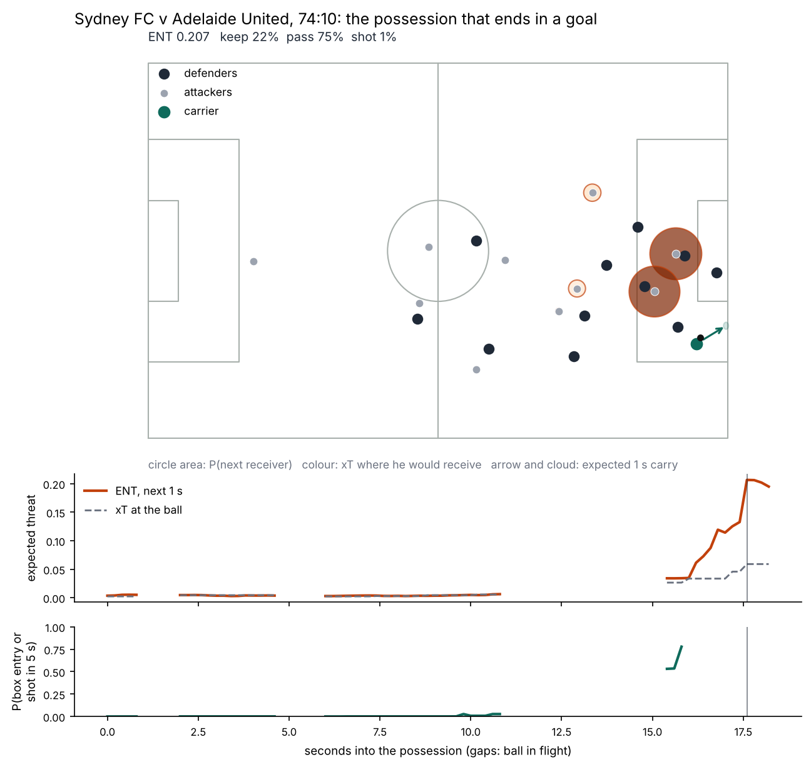
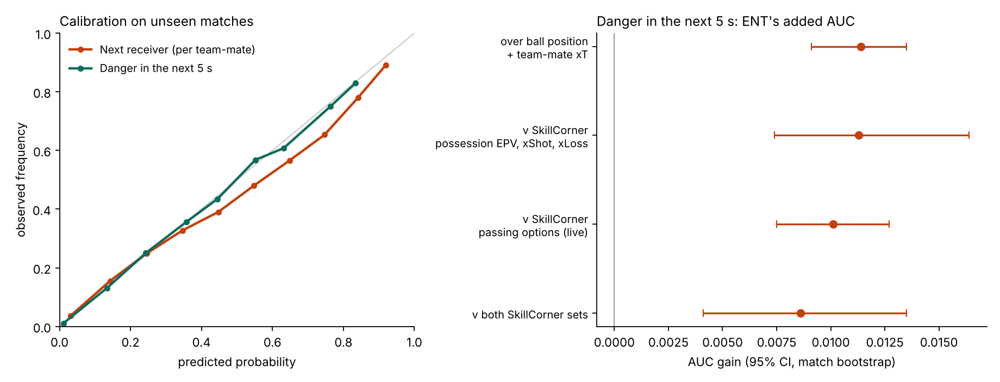

# expected-next-threat

**Where the ball and the danger go next, every 0.2 seconds, on SkillCorner tracking data.**

Event data shows where the ball went; xT shows what its current position is worth. Neither shows the danger about to appear: the runner arriving in the box, or the carrier about to drive past the midfield line.

`expected-next-threat` is an open, calibrated next-action engine. At every on-ball frame it forecasts what the carrier does in the next second (keep the ball, pass, shoot or lose it), who would receive a pass and where a carry would end. It values each outcome with expected threat (xT) or expected goals (xG). The sum is the **expected next threat (ENT)**. A second output, `p_danger5`, is the probability of a box entry or a shot within the next 5 seconds of the same possession.



*Figure 1. Sydney FC's goal against Adelaide United. Circle area: probability of receiving the next pass; colour: xT at the reception point; arrow and cloud: the carrier's expected position in 1 s. Below, ENT (orange) rises while the ball's own xT (grey) stays low. Gaps are passes in flight. In-sample example.*

## What it computes

```
ENT = P(keep) x E[xT where a 1 s carry ends]
    + P(pass) x sum over team-mates j of P(receiver = j) x xT(where j will be)
    + P(shot) x xG(here)
    + P(lose it) x 0
```

## How it is built

Three learned models and two value maps, all fitted on SkillCorner's 20 open A-League 2024/25 matches.

- **Receiver model:** LightGBM over every outfield team-mate (positions, passing lanes, nearest defenders, the runner's last second of movement, the passer's movement towards each candidate), softmaxed within the frame. It is trained on every on-ball frame, not only at the moment of the pass, so it stays calibrated when used live.
- **Action model:** keep, pass, shoot or lose it in the next second, from the carrier's position, speed, pressure and the receiver layer. P(shot) is recalibrated with an isotonic map.
- **Carry model:** the carrier's position in 1 s, with its spread; the expected xT is integrated over that spread.
- **Value maps:** Singh's Markov xT (12 x 8) refitted on SkillCorner possessions, and a distance-angle xG.
- **Danger layer:** `p_danger5` from ball position, team-mate xT, ENT and its 2 s trend.

Every probability model is calibrated on matches it did not train on. The structure follows Fernández, Bornn and Cervone's EPV (2021) and the next-receiver idea in xReceiver (Masella et al.). The contribution here is an open, live, validated version on SkillCorner data.

## Does it work?

All numbers below are out of match: the 20 matches are split into five folds, and each match is scored only by models that never saw it. `python -m expected_next_threat.validate` reproduces every number in this section. They are associations, not causal effects.



*Figure 2. Left: predicted v observed frequency on unseen matches. Right: added AUC for predicting a box entry or shot in the next 5 s, with 95% match-bootstrap intervals.*

- **Next receiver:** the right team-mate ranks first 48.6% of the time (chance 11.0%, about 9 candidates) and in the top three 81.7%. Calibration error is 0.004 per team-mate.
- **Next action:** log-loss 0.746 against 0.889 for the same learner on location only; calibration error 0.014 or less per class.
- **Carry:** where the carrier is 1 s later, R² 0.91 forward and 0.90 sideways (constant velocity: 0.69 and 0.63).
- **Danger in the next 5 s:** AUC 0.932, calibration error 0.002. ENT adds +0.011 AUC [0.009, 0.014] over ball position, ball xT and team-mate xT, and its trend adds a further +0.002.
- **Against SkillCorner's own live values** (frames more than 1 s before the pass or shot): ENT beats possession EPV, xShot and xLoss by +0.011 [0.007, 0.016] and the passing options available at that moment by +0.010 [0.007, 0.013], and adds +0.011 beyond both together.

SkillCorner's passing options, as listed, are anchored on the pass that was actually played: in the final moments before a pass, the eventual receiver is almost always in the menu. They are built to explain a pass afterwards; this engine forecasts before it. The comparison above uses only options that had already peaked, which is what a live system would see.

## Limits

- The gains over naive tracking are real but modest, about +0.01 AUC.
- The receiver model is calibrated on average, but slightly over-confident between 0.4 and 0.8, and its confidence does not change with how long the carrier has had the ball.
- The carry horizon is 1 s; longer dribbles are a chain of 1 s steps. The pass part ignores completion probability: it means "if the pass is played and arrives".
- Twenty matches from one league, with broadcast tracking (about 58% of player-frames detected). No player rankings: 20 matches cannot support them.
- The pretrained models use all 20 matches, so the demo is in-sample; the evaluation above is not.

## Install and run

Python 3.10 or later.

```bash
pip install git+https://github.com/varunrout/expected-next-threat
```

```python
from expected_next_threat import NextThreatEngine, load_match

engine = NextThreatEngine.pretrained()
match = load_match(1996435)            # downloads and caches the open data on first use
live = engine.predict_match(match)     # one row per 0.2 s on-ball frame
engine.plot_frame(match, live, clock="75:50")
```

Worked example: [`notebooks/demo.ipynb`](notebooks/demo.ipynb). `scripts/train.py` retrains the models (about 25 minutes). Data is read from SkillCorner's repository at a pinned commit (`4340d27`).

## Credits and licence

Data: [SkillCorner open data](https://github.com/SkillCorner/opendata). Built for the PySport x SkillCorner Analytics Cup 2.0. MIT licence.
